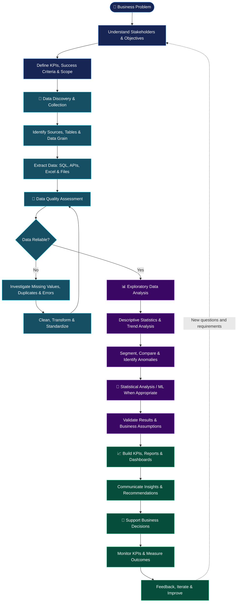

<!--
  GitHub Profile README
  Owner: Patty-09
  Replace any placeholder links before publishing.
-->

 

---

## 👩‍💻 About Me

I'm **Pratibba Patel**, a B.Tech graduate in Data Science with a strong interest in Data Analytics, business intelligence, Machine Learning, and data-driven problem-solving.

I enjoy working with data to uncover patterns, build meaningful visualizations, and communicate insights that support better decisions. My work also includes Machine Learning and geospatial research in digital soil mapping.

- 🎓 **Education:** B.Tech in Data Science, 2026
- 🏫 **College:** St. Vincent Pallotti College of Engineering and Technology, Nagpur
- 🏆 **CGPA:** 9.36/10
- 📊 **Primary focus:** Data Analytics & Business Intelligence
- 🧠 **Additional interests:** Machine Learning, geospatial analytics & environmental data
- 🛠️ **Core tools:** SQL, Excel, Power BI & Python

> My goal is to turn complex data into clear insights, useful visualizations, and practical solutions.

## 🔄 My End-to-End Data Analytics Workflow

I approach data analytics as an end-to-end problem-solving process: understanding business needs, preparing reliable data, discovering meaningful patterns, validating findings, and translating results into actionable insights.

### 🗺️ The Complete Analytics Lifecycle

### 01 · 🎯 Business Understanding

**Objective:** Solve the right problem before analyzing the data.

- Understand stakeholder requirements and business context.
- Translate business questions into measurable analytical objectives.
- Define KPIs, metrics, targets, and success criteria.
- Establish the reporting period, level of detail, and scope.
- Identify assumptions, constraints, and potential data limitations.

**Deliverable:** A clearly defined analytical problem and KPI specification.

### 02 · 🔌 Data Discovery & Collection

**Objective:** Identify reliable data sources and understand their structure.

- Explore relational databases, spreadsheets, APIs, and external datasets.
- Use SQL to extract relevant records and join related tables.
- Understand table relationships, primary keys, and data granularity.
- Check source coverage, date ranges, field definitions, and data lineage.
- Document source limitations and refresh requirements.

**Tools:** MySQL, SQL, Excel, Python, REST APIs, and YouTube Data API v3.

**Deliverable:** A traceable dataset aligned with the business requirements.

### 03 · 🧹 Data Quality & Preparation

**Objective:** Make the data consistent, accurate, and fit for analysis.

- Profile columns, data types, distributions, and missing values.
- Identify duplicate records, invalid values, and inconsistent categories.
- Standardize formats, dates, units, and naming conventions.
- Investigate outliers rather than removing them automatically.
- Validate joins, record counts, keys, and business rules.
- Create reusable transformations and document cleaning decisions.

**Tools:** SQL, Excel Power Query, Python, Pandas, and NumPy.

**Deliverable:** A documented, analysis-ready dataset with quality checks.

### 04 · 🔍 Exploratory Data Analysis

**Objective:** Understand what happened, identify patterns, and investigate why.

- Calculate descriptive statistics and distributions.
- Analyze trends, seasonality, and changes over time.
- Compare performance across categories, regions, products, or customer segments.
- Investigate anomalies and relationships between variables.
- Use segmentation and drill-down analysis to identify meaningful differences.
- Form hypotheses and validate them against the available evidence.

**Tools:** SQL, Python, Pandas, NumPy, Excel, and visualization libraries.

**Deliverable:** Evidence-backed findings and questions for deeper investigation.

### 05 · 🧠 Statistical Analysis & Machine Learning

**Objective:** Apply more advanced methods when they help answer the question.

- Use appropriate statistical methods to evaluate patterns and hypotheses.
- Select relevant features and prepare model inputs when prediction is required.
- Choose suitable algorithms for classification, regression, or clustering.
- Establish appropriate baselines and evaluate model performance.
- Use train/test splits and suitable validation methods to reduce leakage.
- Interpret limitations and communicate uncertainty.

**Tools:** Python, scikit-learn, R, and relevant geospatial tools.

**Deliverable:** Validated analytical results or a model that addresses a defined problem.

*Machine Learning is an optional branch of the workflow, not a mandatory step for every reporting project.*

### 06 · 📐 KPI Design & Analytical Validation

**Objective:** Ensure that metrics and conclusions are correct and reproducible.

- Define consistent KPI formulas, filters, and reporting periods.
- Reconcile dashboard totals with SQL queries and source records.
- Test calculations, relationships, and aggregation logic.
- Check edge cases, duplicate counting, and missing data.
- Distinguish correlation from causation.
- Review whether findings support the original business question.

**Tools:** SQL, Excel, Power BI, DAX, and Python.

**Deliverable:** Trusted metrics and defensible analytical conclusions.

### 07 · 📊 Data Visualization & Reporting

**Objective:** Communicate complex findings clearly.

- Select visuals that match the analytical question.
- Build KPI cards, trend charts, comparisons, and drill-down views.
- Design interactive dashboards with useful filters and slicers.
- Model relationships and create appropriate DAX measures.
- Use clear labels, consistent units, and accessible visual design.
- Include context, comparisons, and explanations—not just charts.

**Tools:** Power BI, Excel, Power Query, Power Pivot, and Python.

**Deliverable:** An interactive dashboard or report that supports informed decisions.

### 08 · 💡 Insights & Business Recommendations

**Objective:** Turn findings into practical next steps.

- Explain what changed, where it changed, and how much it changed.
- Identify possible drivers and distinguish evidence from assumptions.
- Quantify business impact where reliable data permits.
- Prioritize recommendations by expected impact and feasibility.
- Present the findings in concise, stakeholder-friendly language.
- Explain limitations and suggest follow-up analysis.

**Deliverable:** A clear narrative connecting data, findings, and recommended actions.

### 09 · 🔁 Monitoring & Continuous Improvement

**Objective:** Keep analytical outputs useful after delivery.

- Track KPI movement against targets and previous periods.
- Validate refreshes and investigate unexpected changes.
- Maintain consistent metric definitions and documentation.
- Gather stakeholder feedback and improve reports.
- Revisit assumptions when business conditions or data sources change.
- Measure outcomes when sufficient post-implementation data becomes available.

**Deliverable:** Reliable reporting that evolves with business needs.

---

### 🛠️ How I Apply This Workflow

| Analytics stage | My practical tools |
|---|---|
| Data extraction | SQL, MySQL, APIs |
| Cleaning and transformation | Excel, Power Query, Python, Pandas |
| Exploration and analysis | SQL, Excel, Python, statistics |
| Machine Learning and research | Python, scikit-learn, R, Google Earth Engine, GIS |
| KPI development | SQL, Excel, Power BI, DAX |
| Visualization and reporting | Power BI, Excel |
| Version control and documentation | Git, GitHub |

**From raw data to reliable insights and better decisions.**

## 🧰 Tech Stack

### Data Analytics & Business Intelligence

### Programming & Data Science

### Machine Learning & Geospatial Research

### Development & Other Tools

## 🚀 Featured Projects

### 📊 Data Analytics & Business Intelligence

<table>
<tr>
<td width="50%" valign="top">

<h3>🏥 Hospital ER Executive Dashboard</h3>

An interactive dashboard project focused on emergency-room reporting and exploring operational patterns in healthcare data.

**Tools:** Excel, Power Query, Power Pivot, PivotTables and Power BI-related analytics.

</td>
<td width="50%" valign="top">

<h3>🛍️ ShopSmart Retail Analytics</h3>

A retail analytics project using SQL and Python to explore data, investigate business patterns, and support data-driven retail decisions.

**Tools:** Python and MySQL.

</td>
</tr>
<tr>
<td width="50%" valign="top">

<h3>🏏 IPL Performance Analytics</h3>

A sports analytics project combining SQL and Power BI to explore IPL performance data and present findings through visual analytics.

**Tools:** SQL, Power BI and Python.

</td>
<td width="50%" valign="top">

<h3>▶️ YouTube Content Performance Analytics</h3>

Analyzed 2,000+ YouTube videos collected using the YouTube Data API v3 to explore content reach, engagement, video duration, categories, channels, and publishing behavior.

**Tools:** Python, Jupyter Notebook and YouTube Data API v3.

</td>
</tr>
</table>

## 🧠 Machine Learning & Research

### 🌱 Digital Soil Mapping | ICAR–NBSS&LUP

**Machine Learning & Data Analytics Intern | Nagpur**

My internship involves digital soil mapping and the analysis of regional soil and environmental datasets.

Areas of work include:

- Processing and preparing regional soil datasets for spatial analysis.
- Working with remote sensing and terrain data, including Sentinel, Landsat, and Digital Elevation Models (DEM).
- Exploring Google Earth Engine and USGS EarthExplorer for geospatial data.
- Using R for data preprocessing, clipping, and parameter extraction.
- Working with ArcMap and SAGA GIS for geospatial analysis.
- Contributing to Machine Learning-assisted soil-map prediction and visualization workflows.

**Research direction:** Integrating environmental and geospatial data to support digital soil mapping.

*Specific models, evaluation metrics, and research outcomes will be added when verified against the actual work.*

### 🔬 Machine Learning Knowledge

My Data Science background includes studying:

- Supervised and unsupervised learning
- Classification and regression
- Random Forest
- Support Vector Machines (SVM)
- K-Nearest Neighbors (KNN)
- XGBoost
- Model evaluation and exploratory data analysis

I aim to connect statistical reasoning and Machine Learning with real-world data problems.

## 💼 Experience

### ICAR–NBSS&LUP, Nagpur
**ML & Data Analytics Intern | January 2026–Present**

Working on digital soil mapping, geospatial data preparation, environmental datasets, and Machine Learning-related research workflows.

### Ramdeobaba Internship
**Internship experience**

Details of the role, dates, and contributions can be added here after verification.

## 🎓 Education

**B.Tech in Data Science — 2026**

St. Vincent Pallotti College of Engineering and Technology, Nagpur

**CGPA: 9.36/10**

## 📈 GitHub Analytics

 

## 🌱 Currently Focused On

- Strengthening SQL, Excel, Power BI, and Python for Data Analyst roles.
- Improving dashboard design, KPI reporting, and business storytelling.
- Exploring Machine Learning workflows and geospatial analytics.
- Building practical projects and documenting my learning on GitHub.

## 🤝 Let's Connect

### ✨ Explore the data. Discover the patterns. Deliver the insights.

