 

### Turning Data into Decisions 📊

**B.Tech Data Science Graduate | Data Analytics | Business Intelligence**

*Seeking opportunities as a Data Analyst, SQL Developer, Power BI Developer, BI Analyst, or Reporting Analyst.*

---

## 👩‍💻 About Me

Hi! I'm **Pratibba Patel**, a B.Tech Data Science graduate who enjoys working with data, finding meaningful patterns, and turning raw information into actionable insights.

My focus is on combining SQL, Excel, Python, and Power BI to solve analytical problems, build dashboards, and support better business decisions.

- 📊 Interested in Data Analytics, Business Intelligence, and Reporting.
- 🗄️ Experienced with SQL/MySQL, Excel, Power BI, and Python.
- 📈 Build end-to-end analytics projects, from data preparation to visualization.
- 🔌 Have worked with APIs, including YouTube Data API v3.
- 🌍 Have internship exposure to machine learning and geospatial data analysis.
- 🌱 Currently strengthening my technical skills and business problem-solving.
- 💼 Open to suitable entry-level opportunities in Pune, Nagpur, and other locations.

## 🔄 My Data Analytics Workflow

```mermaid
flowchart LR
    A["📥 Collect"] --> B["🧹 Clean"]
    B --> C["🗄️ SQL & Model"]
    C --> D["🔍 Analyze"]
    D --> E["📊 Visualize"]
    E --> F["💡 Insights"]
    F --> G["🎯 Decisions"]

    style A fill:#DCEBFF,stroke:#4F81BD,color:#172B4D
    style B fill:#DCEBFF,stroke:#4F81BD,color:#172B4D
    style C fill:#DCEBFF,stroke:#4F81BD,color:#172B4D
    style D fill:#DDF5E5,stroke:#39966B,color:#173D2A
    style E fill:#DDF5E5,stroke:#39966B,color:#173D2A
    style F fill:#FFF0CC,stroke:#C99A32,color:#5C4310
    style G fill:#FFF0CC,stroke:#C99A32,color:#5C4310
```

## 🚀 Featured Projects

### 1. 🏥 Hospital ER Executive Dashboard

**Tools:** Excel, Power Query, Power Pivot, PivotTables, DAX

- Analyzed emergency department data to understand patient and operational trends.
- Organized data for reporting and KPI tracking.
- Used PivotTables, charts, slicers, and dashboard elements to make results easier to explore.
- Focused on presenting operational information clearly for decision-making.

[🔗 View Repository](https://github.com/Patty-09/Hospital-ER-Executive-Dashboard)

### 2. 🛍️ ShopSmart Retail Analytics System

**Tools:** MySQL, SQL, Excel, Power BI

- Developed a retail analytics project focused on sales and business performance.
- Used SQL to query and analyze structured retail data.
- Explored product, sales, and performance metrics to identify useful patterns.
- Designed the project around turning transactional data into business insights.

[🔗 View Repository](https://github.com/Patty-09/shopsmart-retail-analytics)

### 3. 🏏 IPL Performance Analytics

**Tools:** SQL, MySQL, Power BI

- Analyzed IPL data to explore team and player performance.
- Used SQL queries to retrieve and aggregate relevant statistics.
- Applied analytical techniques to compare performance across matches and seasons.
- Presented insights through data visualization.

[🔗 View Repository](https://github.com/Patty-09/ipl-performance-analytics-powerbi-sql)

### 4. ▶️ YouTube Content Performance Analytics

**Tools:** Python, YouTube Data API v3, SQL, Power BI

- Worked with YouTube API data to explore content performance.
- Focused on metrics such as views, likes, comments, and engagement.
- Used Python for data retrieval and preparation.
- Structured the analysis to support performance comparisons and dashboard reporting.

[🔗 View Repository](https://github.com/Patty-09/youtube-content-performance-analytics)

### 5. 📈 Sales Analytics Dashboard

**Tools:** Excel, Power BI, SQL

- Explored sales performance and business KPIs.
- Organized data for analysis and reporting.
- Designed visual summaries to make trends and comparisons easier to understand.

[🔗 Explore My GitHub Repositories](https://github.com/Patty-09?tab=repositories)

> **Note:** Confirm that the project links above match your actual repository names. Add verified screenshots, dataset details, and measurable results to each project README when available.

## 🛠️ Technical Skills

**Data Analysis & Programming**

**BI & Data Visualization**

**Tools & Platforms**

**SQL & Databases**
- Joins, aggregate functions, subqueries
- CTEs and window functions
- Views, indexes, stored procedures, and triggers
- Data extraction, querying, and analysis

**Excel**
- PivotTables and PivotCharts
- Power Query and Power Pivot
- Dashboards, slicers, and data validation
- Conditional formatting and data cleaning

**Power BI**
- Interactive dashboards and KPI reporting
- Data modeling and relationships
- DAX fundamentals and measures
- Filters, slicers, and visual storytelling

**Python**
- Pandas and NumPy
- Data cleaning and exploratory analysis
- Data visualization
- API data retrieval and MySQL connectivity

**Additional Skills**
- Statistics and exploratory data analysis
- Data quality and business analysis
- REST APIs and ODBC
- Machine learning fundamentals
- Geospatial data processing and visualization

## 🌍 Internship Experience

### ICAR–NBSS&LUP, Nagpur
**ML & Data Analytics Intern | January 2026 – Present** *(verify dates and current status before publishing)*

- Contributed to digital soil mapping and regional soil-data workflows.
- Worked with satellite and environmental datasets, including Sentinel, Landsat, and digital elevation models (DEM).
- Used Google Earth Engine and USGS EarthExplorer for geospatial data sourcing and exploration.
- Used R for preprocessing, clipping, and parameter extraction.
- Worked with tools including ArcMap and SAGA GIS.
- Gained exposure to machine-learning-based soil mapping and visualization.

### Ramdeobaba Internship
**Internship Experience**

Add your exact role, dates, technologies, and contributions here so this section accurately reflects your experience.

## 🎓 Education

**Bachelor of Technology (B.Tech) — Data Science**

St. Vincent Pallotti College of Engineering and Technology, Nagpur

- **Graduation:** 2026
- **CGPA:** 9.36/10

## 📚 Currently Learning & Improving

- Advanced SQL problem-solving and interview questions
- Power BI DAX and data modeling
- Python for analytics and automation
- Git/GitHub workflows and API integration
- Cloud and broader entry-level technology skills
- Communicating analytical findings through business-focused storytelling

## 📊 GitHub Statistics

## 🤝 Let's Connect

I'm open to connecting with recruiters, analysts, developers, and teams working on data-driven solutions.

- **GitHub:** [Patty-09](https://github.com/Patty-09)
- **LinkedIn:** [Connect with me](YOUR-LINKEDIN-URL)
- **Location preference:** Pune / Nagpur, India
- **Open roles:** Data Analyst, SQL Developer, BI Analyst, Power BI Developer, Reporting Analyst

### Thanks for visiting my profile! 💙

*Learning continuously. Building practically. Turning data into insights.*

