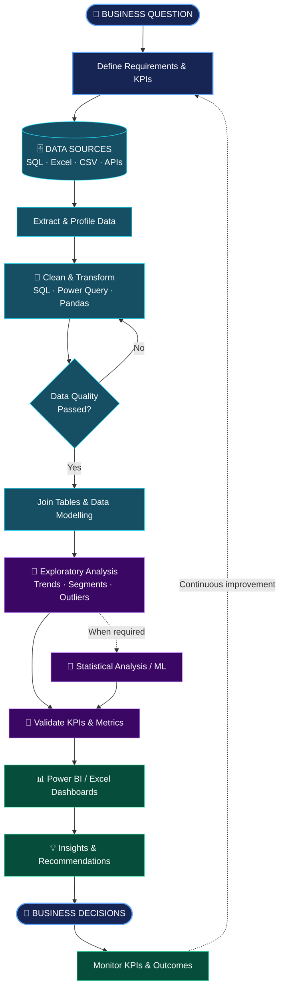

 

  

  

---

## 👩‍💻 About Me

I'm **Pratibba Patel**, a 2026 B.Tech graduate in Data Science from **St. Vincent Pallotti College of Engineering and Technology, Nagpur**, with a **CGPA of 9.36/10**.

My primary interest is Data Analytics and Business Intelligence — working with data, identifying patterns, building dashboards, and turning analysis into useful insights. My experience also includes Machine Learning-related research and geospatial data workflows.

- 📊 **Primary career focus:** Data Analyst and SQL Developer
- 🎓 **Education:** B.Tech in Data Science, 2026
- 🏆 **CGPA:** 9.36/10
- 🧰 **Core skills:** SQL, MySQL, Excel, Power BI and Python
- 🧠 **Additional skills:** Machine Learning, statistics, data visualization and geospatial analytics
- 🌱 **Research:** Digital soil mapping and environmental datasets at ICAR–NBSS&LUP
- 🛠️ **Tools:** Git, GitHub, VS Code, APIs and Python–MySQL connectivity

> Understand the problem. Trust the data. Discover the patterns. Deliver the insights.

## 🟢 Open to Work

Interested in suitable entry-level and junior opportunities involving data analysis, SQL development, business intelligence, reporting, dashboard development and data-driven problem-solving.

📍 **Preferred locations:** Pune and Nagpur, India.

---

## 🔄 End-to-End Data Analytics Workflow

---

## 🚀 Featured Projects

<table>
<tr>
<td width="50%" valign="top">

### 🏥 Hospital ER Executive Dashboard

Healthcare analytics and executive reporting, with a focus on exploring operational patterns and presenting information through dashboards.

**Key areas**
- Data preparation and transformation
- PivotTables and reporting
- Time-based analysis and dashboard design

**Tools:** Excel, Power Query, Power Pivot and PivotTables.

</td>
<td width="50%" valign="top">

### 🛍️ ShopSmart Retail Analytics

A retail analytics project focused on exploring business data and finding patterns that can support data-driven decisions.

**Key areas**
- SQL-based data analysis
- Retail performance exploration
- Data preparation and reporting

**Tools:** MySQL and Python; verify the final tool list against the repository.

</td>
</tr>
<tr>
<td width="50%" valign="top">

### 🏏 IPL Performance Analytics

Sports analytics using SQL and Power BI to explore IPL performance data and present findings through visual reporting.

**Key areas**
- SQL queries and aggregations
- Performance comparisons
- Dashboard-based storytelling

**Tools:** SQL and Power BI.

</td>
<td width="50%" valign="top">

### ▶️ YouTube Content Performance Analytics

Analyzed **2,000+ YouTube videos** collected using the YouTube Data API v3 to explore content performance and publishing patterns.

**Key areas**
- Content reach and engagement
- Video duration and categories
- Channel and publishing behavior

**Tools:** Python, Jupyter Notebook and YouTube Data API v3.

</td>
</tr>
</table>

---

## 🧰 Technical Skills

### Data Analytics & Business Intelligence

### Programming & Data Analysis

### Machine Learning

### Geospatial & Environmental Data

### Development & Other Tools

---

## 🌱 Machine Learning & Geospatial Research

### ICAR–NBSS&LUP, Nagpur

**ML & Data Analytics Intern | January 2026–Present** *(verify current status before publishing)*

- Work with regional soil and environmental datasets for digital soil mapping.
- Explore Sentinel, Landsat and Digital Elevation Model (DEM) data.
- Use Google Earth Engine and USGS EarthExplorer in geospatial workflows.
- Use R for preprocessing, clipping and parameter extraction.
- Work with ArcMap and SAGA GIS for spatial analysis.
- Contribute to Machine Learning-related soil-map prediction and visualization workflows.

**Research workflow**

`Geospatial Data` → `Preprocessing` → `Environmental Parameters` → `ML Workflow` → `Soil Map Visualization`

### Machine Learning Concepts

- Supervised and unsupervised learning
- Classification and regression
- Random Forest, SVM, KNN and XGBoost
- Exploratory data analysis and model evaluation

*Listed algorithms represent technical knowledge and interests; document specific implementations and measured results only where verified.*

---

## 💼 Experience

### ICAR–NBSS&LUP, Nagpur
**ML & Data Analytics Intern** · January 2026–Present *(verify current status)*

Digital soil mapping, geospatial preprocessing, environmental datasets and Machine Learning-related research workflows.

### Ramdeobaba Internship

Add the exact role, dates and responsibilities after verification.

---

## 🎓 Education

**St. Vincent Pallotti College of Engineering and Technology, Nagpur**

---

## 📊 GitHub Analytics

 

 

---

## 🎯 Current Focus

- Strengthening SQL, Excel, Power BI, Python and analytical problem-solving.
- Improving dashboard design, KPI reporting and data storytelling.
- Building and documenting practical analytics projects.
- Developing skills in Machine Learning and geospatial workflows.

---

## 🤝 Connect With Me

### Explore the data. Discover the patterns. Deliver the insights.

