 

### Turning Data into Decisions

**B.Tech Data Science Graduate · Analytics · Business Intelligence**

*Data Analyst · SQL Developer · Power BI Developer · BI Analyst · Reporting Analyst*

---

## 👩🏻‍💻 About Me

<table>
<tr>
<td width="65%" valign="top">

Hi, I'm **Pratibba Patel**, a Data Science graduate passionate about turning raw data into meaningful insights.

- 📊 Building analytics dashboards and reporting solutions
- 🗄️ Querying and analyzing data using SQL and MySQL
- 🐍 Using Python for data preparation and analysis
- 📈 Translating KPIs and patterns into business insights
- 🌍 Exploring machine learning and geospatial analytics

**Currently seeking:** Data Analyst, SQL Developer, BI Analyst, Power BI Developer, and Reporting Analyst opportunities.

</td>
<td width="35%" align="center" valign="middle">

</td>
</tr>
</table>

## 🔄 My Analytics Workflow

```mermaid id="q4hv9m"
flowchart LR
    A["📥 Collect"] --> B["🧹 Clean"]
    B --> C["🗄️ Query"]
    C --> D["🔎 Analyze"]
    D --> E["📊 Visualize"]
    E --> F["💡 Insights"]
    F --> G["🎯 Decisions"]

    style A fill:#E5F0FF,stroke:#6096D6,color:#17365D
    style B fill:#E5F0FF,stroke:#6096D6,color:#17365D
    style C fill:#E5F0FF,stroke:#6096D6,color:#17365D
    style D fill:#DFF5E6,stroke:#52A675,color:#174D2A
    style E fill:#DFF5E6,stroke:#52A675,color:#174D2A
    style F fill:#FFF0D5,stroke:#D5A044,color:#6B4C13
    style G fill:#FFF0D5,stroke:#D5A044,color:#6B4C13
```

## 🚀 Featured Projects

<table>
<tr>
<td width="50%" valign="top">

<h3>🏥 Hospital ER Dashboard</h3>

**Goal:** Understand emergency department performance through KPIs and visual reporting.

**Technology Stack**

**Focus:** Patient trends · Operational KPIs · Interactive reporting

<a href="https://github.com/Patty-09/Hospital-ER-Executive-Dashboard">↗ View Project</a>

</td>
<td width="50%" valign="top">

<h3>🛍️ ShopSmart Retail Analytics</h3>

**Goal:** Analyze retail data to understand sales and product performance.

**Technology Stack**

**Focus:** Sales analysis · Product performance · Business insights

<a href="https://github.com/Patty-09/shopsmart-retail-analytics">↗ View Project</a>

</td>
</tr>
<tr>
<td width="50%" valign="top">

<h3>🏏 IPL Performance Analytics</h3>

**Goal:** Explore cricket match, team, and player performance using data.

**Technology Stack**

**Focus:** Aggregations · Performance comparisons · Data visualization

<a href="https://github.com/Patty-09/ipl-performance-analytics-powerbi-sql">↗ View Project</a>

</td>
<td width="50%" valign="top">

<h3>▶️ YouTube Content Analytics</h3>

**Goal:** Analyze video performance and engagement metrics using API data.

**Technology Stack**

**Focus:** Views · Likes · Comments · Content performance

<a href="https://github.com/Patty-09/youtube-content-performance-analytics">↗ View Project</a>

</td>
</tr>
</table>

## 🧰 Technical Toolbox

<table>
<tr>
<td align="center" width="33%">

### 🗄️ Data & SQL

**SQL · MySQL · Python**

Joins · CTEs · Window Functions · Views · Indexes · Stored Procedures · Triggers

</td>
<td align="center" width="33%">

### 📊 BI & Reporting

**Excel · Power BI**

Power Query · Power Pivot · PivotTables · DAX Fundamentals · KPIs · Dashboards

</td>
<td align="center" width="33%">

### ⚙️ Tools & Analysis

**Git · GitHub · VS Code**

Pandas · NumPy · REST APIs · ODBC · Statistics · Data Cleaning

</td>
</tr>
</table>

### 🌱 Additional Exposure

`Machine Learning` `Classification & Regression` `Random Forest` `SVM` `KNN` `XGBoost` `R` `Google Earth Engine` `ArcMap` `SAGA GIS` `Sentinel` `Landsat` `DEM`

## 🌍 Internship Experience

<table>
<tr>
<td width="100%" valign="top">

### 🌱 ICAR–NBSS&LUP, Nagpur

**ML & Data Analytics Intern** · January 2026 – Present *(verify current status)*

- Contributed to digital soil mapping and regional soil-data workflows.
- Worked with satellite and environmental datasets, including Sentinel, Landsat, and DEM.
- Used Google Earth Engine and USGS EarthExplorer for geospatial data sourcing.
- Used R for data preprocessing, clipping, and parameter extraction.
- Gained exposure to machine-learning-based soil mapping and visualization.

**Tools:** `R` `Google Earth Engine` `USGS EarthExplorer` `ArcMap` `SAGA GIS`

</td>
</tr>
<tr>
<td width="100%" valign="top">

### 🎓 Ramdeobaba Internship

Add your confirmed role, dates, tools, and key contributions here.

**Tools:** Replace with the technologies you actually used.

</td>
</tr>
</table>

## 🎓 Education

<table>
<tr>
<td width="70%">

**B.Tech in Data Science**

St. Vincent Pallotti College of Engineering and Technology, Nagpur

</td>
<td align="center" width="30%">

**Graduated: 2026**

</td>
</tr>
</table>

## 📈 GitHub Activity

## 🎯 What I'm Working Toward

<table>
<tr>
<td align="center" width="25%">

📊

**Analytics**

Building stronger business analysis and reporting skills.

</td>
<td align="center" width="25%">

🗄️

**SQL**

Practicing query optimization and interview problems.

</td>
<td align="center" width="25%">

📈

**BI**

Improving dashboards, DAX, and data modeling.

</td>
<td align="center" width="25%">

💼

**Career**

Seeking suitable opportunities in data and technology.

</td>
</tr>
</table>

## 🤝 Let's Connect

**Open to:** Data Analyst · SQL Developer · Power BI Developer · BI Analyst · Reporting Analyst

📍 **Preferred locations:** Pune & Nagpur, India

*Learning continuously. Building practically. Turning data into insights.*

